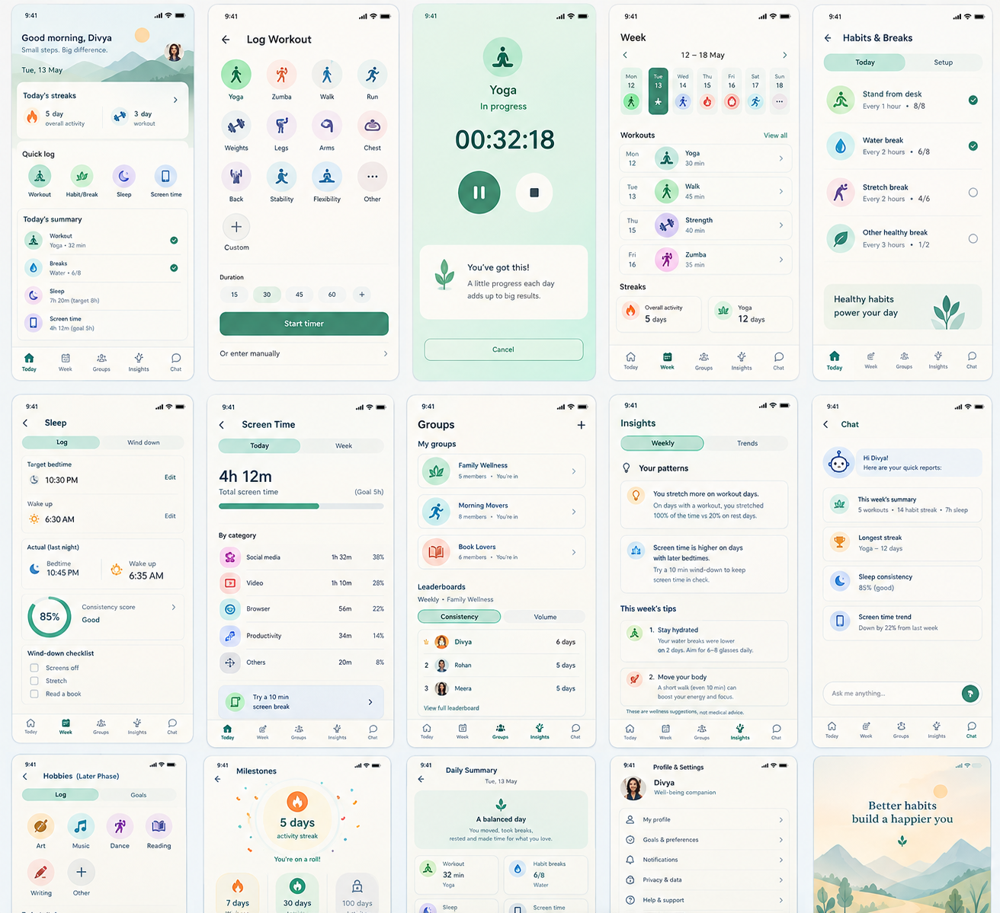

# Well Being Companion (WBC): Revised Build Spec

Audience for this file: the developer (or AI coding tool) building the app. Design inputs come from the product owner; technical decisions are confirmed by the developer. Items marked **[Proposal]** are defaults that can be changed.

---

## 1. Product Summary

A minimalist well-being app for daily movement, healthy habits, hobbies, sleep, and screen time. Principle: **one tap to log, one glance to understand.**

- **Audience:** family and friends. Self-made, non-commercial, free.
- **Platform:** Android first. Keep architecture and design portable to iOS.
- **Users:** desk workers who want regular breaks; people who work out consistently (no advanced performance analytics); small groups who want gentle accountability.
- **Constraints:** minimal running cost (free tiers, minimal LLM usage), flexible timeline, MVP as early as possible.

### Non-goals (for now)
- Heart rate / BPM or wearable-based performance metrics.
- Automatic sleep detection (sleep is entered manually).
- Monetization, ads, subscriptions.
- iOS release.
- Colour-blind-safe palette and screen-reader support (deferred). Keep large tap targets and dark mode.

---

## 2. Phases

| Phase | Scope |
|---|---|
| **MVP** | Workout logging (timer and manual), weekly strip, streaks, habit/break reminders, manual sleep log, basic milestones, lightweight groups with one weekly leaderboard, rule-based weekly insights |
| **v1.1** | Screen-time tracking (Android), steps via Health Connect and step leaderboards, daily and monthly boards, shareable weekly recap, curated tips library |
| **v1.2** | Preset-query chatbot, per-metric group privacy, optional LLM-phrased weekly recap |
| **v2** | GPS for walk/run (distance, simple route), hobbies and balance view, group challenges, free-text chatbot, iOS |

Screen time may move into the MVP if the usage-access setup proves quick.

---

## 3. Tech Stack **[Proposal]**

| Layer | Default | Notes |
|---|---|---|
| App | Flutter (Dart) | One codebase, strong custom UI (needed for per-section looks), iOS later |
| Local storage | SQLite via Drift (or Isar) | Local-first: logging works offline |
| Backend | Supabase (Postgres, Auth, Realtime, Row Level Security) | Free tier is likely enough. Firebase is an acceptable alternative |
| Auth | Google sign-in | Simplest on Android |
| Push | Firebase Cloud Messaging | Only for group events (cheers, invites). Habit reminders are local |
| Local notifications | `flutter_local_notifications` | Scheduled on device |
| Charts | `fl_chart` | Weekly views |
| Maps (v2) | MapLibre with OpenStreetMap tiles | Avoids paid map APIs |
| LLM (optional, v1.2+) | Any low-cost model API, one call per user per week | Server-side only, never ship keys in the app |

---

## 4. Design System

### 4.1 Principles
- Minimal: few screens, generous whitespace, one icon set, one typeface.
- Restricted palette: neutrals plus one accent, and two soft section tints. No more than four hues in total.
- Subtle section identity (same system, small variations):
  - **Workout:** slightly bolder. Heavier type weight, full-strength accent, solid icon fills.
  - **Sleep:** calmer. Desaturated cool tint, lighter weights, more spacing.
  - **Hobbies:** slightly doodley. Hand-drawn style dividers and underlines, optional handwritten font on headings only.
- Dark mode supported from the start. Minimum tap target 48dp.

### 4.2 Colour tokens **[Proposal, replace with the owner's palette]**

| Token | Light | Dark | Use |
|---|---|---|---|
| `bg` | `#FAFAF8` | `#121413` | App background |
| `surface` | `#FFFFFF` | `#1B1D1C` | Cards |
| `text` | `#1C1F1E` | `#ECEDEC` | Primary text |
| `text-muted` | `#6B706E` | `#9AA09D` | Secondary text |
| `accent` | `#2F7D6B` | `#4FA68F` | Primary actions, streaks, selected states |
| `tint-sleep` | `#E8EDF3` | `#1E2530` | Sleep screens background wash |
| `tint-hobby` | `#F4ECDD` | `#2B261C` | Hobbies background wash (v2) |

Implementation: define tokens once in a theme object. Each section applies its own tint and weight through a `SectionTheme` wrapper. Do not duplicate screens per section.

### 4.3 Typography
One sans-serif family (for example Inter or the system font). Three sizes for body, title, and display. An optional handwritten font for hobby headings only (v2).

### 4.4 Icons
One outline icon set (Material Symbols Rounded or Phosphor). Each workout type gets one icon:

| Type | Icon idea | Type | Icon idea |
|---|---|---|---|
| Yoga | seated figure | Back | back/spine |
| Zumba | dancing figure | Stability | balance figure |
| Walk | walking figure | Flexibility | stretch figure |
| Run | running figure | Other | dot / plus |
| Weights | dumbbell | Legs / Arms / Chest | body-part glyph or dumbbell variant |

### 4.5 Microcopy rules
- Neutral, sober, brief. No exclamation marks, no cheerleading, no emojis in system text.
- State facts, then stop.
- Never use guilt language (no "you missed", "don't break your streak").

| Situation | Copy |
|---|---|
| Workout saved | `Logged. 35 min yoga.` |
| Streak update | `5-day streak.` |
| Streak milestone | `7-day streak reached.` |
| Rest day marked | `Rest day recorded.` |
| Water reminder | `Water break.` |
| Stand reminder | `Stand and move for a minute.` |
| Weekly recap title | `Week summary` |
| Empty state | `No workouts logged this week.` |
| Tip footer | `General wellness suggestion. Not medical advice.` |

---

## 4.6 GUI Visual Reference

The following generated UI sample is a visual direction reference for the app. It is not a pixel-perfect specification; the written requirements in this document take precedence for functionality, navigation, and screen content.

The reference illustrates the intended overall language: minimalist layouts, generous whitespace, rounded cards, simple workout and habit icons, restrained colour use, clear hierarchy, and a calm well-being-oriented feel. Individual screens and exact UI details should follow the requirements in Section 5 and the design tokens in Section 4.

## 5. Navigation and Screens

Bottom tabs: **Today · Week · Groups · Insights · Chat**. Profile and Settings open from an avatar at top right.

### MVP screens

**Today**
- Header: date, current overall streak.
- Workout card: today's logged workouts or `Log workout`.
- Breaks card: dots or rings for each active habit (water, stand, stretch, custom), tap to log.
- Sleep card: last night's logged sleep or `Log sleep`.
- Quick actions: `Start timer`, `Add manual entry`.

**Log workout** (sheet)
1. Icon grid of workout types (plus `Add custom`).
2. Either `Start timer` (Start/Pause/Stop) or manual start and end time.
3. Optional **Intensity** tap: Low / Mid / High. Skipped by default and never required.
4. Optional note.
5. Save.

**Week**
- Mon to Sun strip showing the workout icon per day (multiple workouts: first icon plus count badge). Rest days show a quiet marker, not a gap.
- Totals: active minutes, active days, workouts per type.
- Streaks: overall and per type.
- Tap a day to view or edit entries.

**Habits and breaks**
- Setup flow per habit: `What do you want to track?` (water / stand / stretch / custom name), daily target count, reminder on/off, reminder times or interval, active days.
- Habit detail: today's count, streak, 4-week history.

**Sleep** (manual)
- Target bedtime and wake time.
- Log: actual bedtime and wake time (defaults to targets, adjustable).
- Consistency score for the last 7 days (see 7.5).
- Optional wind-down checklist (screens off, stretch, reading) with user-editable items.

**Groups**
- List of groups; create group; join by invite link.
- Group screen: member list, recent activity feed (workout type and duration, break completions), weekly leaderboard with a `Volume | Consistency` toggle, reactions (cheer) on feed items.
- Group settings: name, invite link, leave group.

**Insights**
- Weekly insights (rule-based, see 7.7) and one to three tips.
- Weekly recap card.

**Chat**
- MVP: placeholder or hidden. v1.2: preset queries.

**Profile and Settings**
- Name, avatar, sign out.
- Reminders: global quiet hours, daily reminder cap.
- Theme: light, dark, system.
- Data: export (JSON/CSV), delete account.
- Streak settings: weekly rest days.

---

## 6. Data Model

IDs are client-generated UUIDs. Every row has `created_at`, `updated_at`, and `deleted_at` (soft delete) for sync. Times are stored in UTC with the user's timezone offset recorded so the correct local day can be derived.

### 6.1 Core tables (MVP)

**users**
`id, display_name, avatar_url, timezone, day_cutoff_minutes (default 0), quiet_hours_start, quiet_hours_end, daily_reminder_cap, weekly_rest_days (default 2)`

**workout_types**
`id, user_id (null for built-ins), name, icon_key, is_builtin`

**workouts**
`id, user_id, workout_type_id, started_at, ended_at, duration_minutes, intensity (null | low | mid | high), note, source (timer | manual), local_date`

**habits**
`id, user_id, name, kind (water | stand | stretch | custom), daily_target, reminders_enabled, reminder_config (JSON: times or interval, active_days), is_active`

**habit_logs**
`id, habit_id, user_id, logged_at, count, local_date`

**sleep_targets**
`user_id, bedtime_minutes, wake_minutes`

**sleep_logs**
`id, user_id, bedtime_at, wake_at, duration_minutes, local_date (wake date)`

**rest_days**
`id, user_id, local_date`

**streak_state** (cached, recomputable)
`user_id, scope (overall | workout_type:<id> | habit:<id>), current_streak, longest_streak, last_counted_date, freeze_available, freeze_last_granted_on`

**badges_awarded**
`id, user_id, badge_key, awarded_at, context (JSON)`

### 6.2 Groups (MVP)

**groups**
`id, name, owner_id, invite_code, created_at`

**group_members**
`group_id, user_id, role (owner | member), joined_at, share_workouts (bool, default true), share_breaks (bool, default true)`

**group_events** (feed items, written by client or database trigger)
`id, group_id, user_id, kind (workout | break_goal | milestone), payload (JSON: type, duration, habit name), occurred_at`

**reactions**
`id, event_id, user_id, kind (cheer), created_at`

**weekly_group_stats** (view or materialized table)
`group_id, user_id, week_start, active_minutes, active_days, break_goals_met`

### 6.3 Insights (MVP)

**weekly_insights**
`id, user_id, week_start, insight_key, params (JSON), generated_at`

**tips_library**
`id, trigger_key, text, source_label, is_active`

### 6.4 Later phases

- **screen_time_daily** (v1.1): `user_id, local_date, total_minutes, category_minutes (JSON), share_in_groups (bool)`
- **step_daily** (v1.1): `user_id, local_date, steps`
- **hobbies / hobby_logs** (v2): same shape as workout types and workouts, with `category` and `duration_minutes`
- **workout_routes** (v2): `workout_id, polyline, distance_m`

### 6.5 Security
Enable Row Level Security on every table. Rules:
- Users read and write only their own rows.
- Group members read group_events and weekly_group_stats for groups they belong to, limited to the metrics each member shares.
- Sleep logs and screen time are never visible to groups in the MVP.

---

## 7. Logic Rules

### 7.1 Day boundary
`local_date` is derived from the user's timezone and `day_cutoff_minutes` (default midnight). Compute and store it at write time so history does not shift if the timezone changes.

### 7.2 Streaks **[Proposal]**
- **Overall activity streak:** consecutive local days with at least one workout, a recorded rest day, or an applied freeze.
- **Per-type streak:** consecutive days with that workout type, counted the same way. Rest days do not apply to per-type streaks. Consider using "weeks with at least N sessions" for per-type streaks if daily proves too strict.
- **Habit streak:** consecutive days where the daily target is met.
- **Rest days:** the user can mark up to `weekly_rest_days` (default 2) per Mon to Sun week. A rest day keeps the overall streak alive but does not extend it.
- **Freeze:** one freeze is granted per rolling 7 days and is applied automatically to a single missed day. Show it neutrally: `Streak kept. Freeze used.`
- Recompute streaks from logs on app start and after edits. Cached values are for speed only.

### 7.3 Workout timer
Store `started_at` when the timer starts and compute elapsed time from timestamps. Do not rely on a running process. This avoids a foreground service in the MVP. Optionally show an ongoing notification while a timer is active. Pause stores accumulated paused time.

### 7.4 Reminders
- Habit reminders are local scheduled notifications. **Off by default**; enabled per habit.
- Global quiet hours and a daily reminder cap (default 6). If a day exceeds the cap, drop the lowest-priority reminders.
- Batch reminders that fall within 15 minutes into one notification.
- Prefer inexact scheduling. Use exact alarms only if minute-level timing is a real requirement, since they need an extra permission on recent Android versions.
- Reschedule after device reboot and after the user changes settings.
- Suppress a reminder if the habit's target is already met for the day.
- Notification actions: `Log` (increments the count) and `Snooze 30 min`. Cap snoozes at 2.

### 7.5 Sleep consistency score
For the last 7 days, compare actual bedtime and wake time against targets. Score = share of days within a 30-minute tolerance of both targets (shown as `5 of 7 days on schedule`). Show the number only, no colour judgement.

### 7.6 Leaderboards
- Week runs Monday to Sunday in each member's local time, aggregated per group.
- **Volume:** total active minutes in the week.
- **Consistency:** number of days with at least one workout or a met break goal.
- Ties share a rank. Members who have turned off `share_workouts` do not appear.
- MVP: weekly only. v1.1 adds daily and monthly. Steps volume is added in v1.1.

### 7.7 Weekly insights (rule-based)
Generated on Sunday evening or when the user opens Insights after the week ends. Each rule outputs `insight_key + params`, rendered with a text template.

| Key | Rule | Example text |
|---|---|---|
| `stretch_on_workout_days` | Stretch completion higher on workout days by 20 percent or more | `Stretch breaks were completed more often on workout days.` |
| `active_days_change` | Active days differ from the previous week | `4 active days this week, up from 3.` |
| `longest_gap` | Gap of 3 or more days without activity | `Longest gap: 3 days (Tue to Thu).` |
| `water_consistency` | Water target met on 5 or more days | `Water target met on 5 of 7 days.` |
| `sleep_consistency` | Score change versus previous week | `Sleep schedule matched on 5 of 7 days.` |
| `screen_time_late` (v1.1) | Late-evening screen time higher on days with later bedtime | `Later bedtimes followed higher evening screen time.` |

Tips: for each insight, select at most one tip from `tips_library` by `trigger_key`. Show at most three tips per week. Every tip carries the footer `General wellness suggestion. Not medical advice.` Tips avoid extreme goals and are written by the owner or taken from open sources with attribution in `source_label`.

### 7.8 Milestones and badges
Streak badges at 7, 30, and 100 days (overall and per habit). Personal bests: longest streak, most active minutes in a week. Group goals: group total active minutes in a week reaching a set target. Celebrations are a short, quiet animation and one line of text. Each badge is awarded once.

### 7.9 Weekly recap card (shareable in v1.1)
Static card: week range, active days, total minutes, top workout type, longest streak. Rendered to an image for sharing through the Android share sheet. No personal data beyond the above.

---

## 8. Later-Phase Feature Notes

### 8.1 Screen time (v1.1, Android)
- Source: Android `UsageStatsManager`, which requires the user to grant **Usage access** in system settings. Show an in-app explanation screen first, then deep-link to the settings page.
- Read daily totals and per-app and category totals on the device. Upload only daily totals. Sharing in groups is opt-in and off by default.
- Browser time is available per app only, not per website.
- Show daily and weekly totals, an optional daily goal, and a late-evening view.
- On iOS this is heavily restricted, so plan for manual entry or omission there.
- Check current Google Play policy before publishing publicly. Internal or closed testing is sufficient for family and friends.

### 8.2 Steps (v1.1)
Read daily steps from Health Connect (Android). Handle the permission request and the case where Health Connect is not installed. Step leaderboards use daily totals per member.

### 8.3 Chatbot (v1.2)
- Preset queries first: week summary, longest streak, sleep consistency, screen-time trend.
- Each returns a report card computed from local or server data, with no LLM needed.
- Free-text via an LLM (v2): send only a compact summary of the user's own metrics, opt-in, with a system prompt that refuses medical advice.

### 8.4 GPS (v2)
Foreground location tracking for walk and run only, when the user starts a GPS workout. Store distance and a simplified polyline. Show a simple route map on OpenStreetMap tiles. Expect extra work for background location rules and battery use.

### 8.5 Hobbies (v2)
Categories: art, music, dance, reading, writing, custom. Time logging uses the same timer and manual pattern as workouts. Weekly time goals, hobby streaks, a balance view (movement, rest, play), and group challenges (for example a 30-day reading streak). Applies the doodle look through `SectionTheme`.

---

## 9. Android Permissions

| Permission | Phase | Purpose |
|---|---|---|
| `POST_NOTIFICATIONS` (runtime, Android 13+) | MVP | Reminders and group events |
| `RECEIVE_BOOT_COMPLETED` | MVP | Reschedule reminders after reboot |
| `SCHEDULE_EXACT_ALARM` | Only if needed | Exact reminder timing |
| Usage access (`PACKAGE_USAGE_STATS`, granted in settings) | v1.1 | Screen time |
| Health Connect read: steps | v1.1 | Step tracking |
| `ACCESS_FINE_LOCATION` and foreground location | v2 | GPS workouts |

Ask for each permission at the moment it is needed, with a one-line explanation.

---

## 10. Privacy and Safety

- Data is private by default. Group sharing is per member and limited to workouts and break completions in the MVP.
- Sleep and screen time are never shared with groups in the MVP.
- Provide data export and account deletion in Settings.
- Wellness tips are not medical advice and avoid extreme targets.
- Leaderboards are visible only within a group the user chose to join.

---

## 11. Cost Plan

- Hosting: Supabase and Firebase free tiers should cover a family-and-friends user base.
- AI: none required in the MVP. Insights are rule-based and tips come from a curated library.
- From v1.2, at most one LLM call per user per week, server-side, with a spend cap.
- Distribution: Google Play internal or closed testing, or a direct APK.

---

## 12. MVP Build Plan

Work in this order. Each step should leave the app in a runnable state.

- [ ] **1. Project setup:** Flutter project, folder structure, linting, theme tokens, light/dark mode, bottom tab shell.
- [ ] **2. Local database:** Drift schema for MVP tables (6.1), repositories, `local_date` helper.
- [ ] **3. Workouts:** type grid, timer (timestamp-based) and manual entry, optional Intensity (Low/Mid/High), edit and delete, Today workout card.
- [ ] **4. Week view:** Mon to Sun strip with icons, totals, rest day marking.
- [ ] **5. Streaks and milestones:** streak computation (7.2), cached state, badges at 7/30/100, quiet celebration.
- [ ] **6. Habits and reminders:** habit setup flow, logging, local notifications with quiet hours, cap, batching, notification actions, reboot rescheduling.
- [ ] **7. Sleep (manual):** targets, logging, consistency score, optional wind-down checklist.
- [ ] **8. Auth and sync:** Google sign-in, Supabase tables with RLS, sync queue (last write wins on `updated_at`), offline handling.
- [ ] **9. Groups:** create/join by invite link, feed, weekly leaderboard (volume and consistency), cheers, per-member sharing toggles, push for invites and cheers.
- [ ] **10. Insights:** rule engine (7.7), tips library seeded with a small set, Insights screen.
- [ ] **11. Settings and data:** quiet hours, reminder cap, rest days, export, delete account.
- [ ] **12. Release prep:** copy review against the microcopy rules, permissions flow, crash reporting, internal testing track build.

### Acceptance checks for the MVP
- A workout can be logged in three taps or fewer (type, save).
- Logging works offline and syncs later without duplicates.
- Reminders respect quiet hours and the daily cap, and are not sent once the target is met.
- Streaks stay correct after editing or deleting past entries.
- A group member sees only the metrics other members have chosen to share.
- No copy in the app contains exclamation marks.

---

## 13. Open Items

- Final palette and typeface from the owner's design input.
- Developer to confirm the stack in section 3.
- Streak rules in 7.2 (rest days per week, freeze frequency).
- Whether screen time moves into the MVP.
- Seed content for the tips library.
---

# Revised Requirements — 10 October 2026

**Authority:** This section records the product owner's latest decisions and supersedes earlier statements wherever they conflict. Keep all other compatible requirements from the sections above. The GUI reference in Section 4.6 remains part of the build input; use `ui-sample-screens.png` beside this Markdown file. If a visual and a written requirement conflict, follow the written requirement.

## R1. Product name, look and feel, and navigation

- App name: **Well Being Companion**; acronym: **WBC**.
- Match the sample UI's calm, minimal style: spacious layouts, rounded cards, soft green/teal and neutral tones, simple icons, clear type hierarchy, and light/dark appearance. Use the existing design tokens as a starting point and adjust to match the reference.
- Today screen: attractive but restrained background; greeting changes by local time (`Good morning`, `Good afternoon`, `Good evening`); rotate short, catchy well-being taglines.
- Keep bottom navigation: **Today · Week · Groups · Insights · Chat**. Profile/settings opens from the avatar.
- Today screen order: streaks first, then today's logs and quick actions. Quick-access sections/icons: **Workout, Healthy Habits, Hobbies, Sleep, Screen Time**.
- Today's Summary lists today's workout and healthy-habit activities. Use the same summary-card visual language for a selected day in Week.
- Rename **Breaks** to **Healthy Habits** throughout the UI, data labels, and group tabs. Preserve “break” only where it describes the activity itself.

## R2. Streaks and milestone badges

- Show separate streaks for **Workout, Healthy Habits, Hobbies, and Sleep target**.
- Award category badges at **7, 30, 50, 100, 200, and 500 days** for workouts, healthy habits, hobbies, and sleep-target streaks. Earned badges are visually prominent; future milestones are visible but subdued. Each badge is awarded once per category and milestone.
- Workout streak definition: a day with at least one saved workout. Rest-day/freeze behaviour must not silently alter category-specific streaks.
- Healthy-habit streak: consecutive local days meeting that habit's configured daily target. If multiple habits are shown as one combined Healthy Habits streak, define and label the aggregation rule; recommended default is that the user meets the target for at least one active habit, while each habit also retains its own detail streak.
- Hobby streak: based on the user's **user-defined daily or weekly goal**, not merely on logging any hobby. A weekly goal can be met on any days within the configured week; display the streak in completed goal-periods and label it clearly (for example, “4-week goal streak”) rather than implying daily completion.
- Sleep streak: consecutive days meeting the user's configured sleep-duration target. Track sleep schedule consistency separately; do not conflate duration target with bedtime/wake-time consistency.

## R3. Workout logging and metrics

- Workout section has a **Manage** link at the top right. List today's saved workouts and an **Add new workout** action.
- Built-in workout types include Yoga, Zumba, Walk, Run, Weights, Legs, Arms, Chest, Back, Stability, and Flexibility. Remove **Other**; users can add a **Custom** workout type.
- Logging offers **Manual** or **Timer**. Put timer/manual entry inside the workout logging flow; do not show duplicate top-level timer/manual actions that bypass workout selection.
- Timer records start, pause, resume, and stop using timestamps so elapsed time survives app backgrounding. Manual logging permits duration or start/end time.
- Show saved workout details whenever the user opens a workout record from Today, Week, history, or another screen. Display applicable metrics consistently:
  - Duration (timer-calculated or manually entered).
  - Estimated calories, using workout/activity type, duration, and the user's weight when available. Label clearly as an estimate; never imply measured energy expenditure.
  - For walk/run: steps when available, distance, and average speed. Use Android step data integration when permission is granted; otherwise state unavailable or use a clearly labelled estimate. Distance may be GPS-based when the user opts in or estimated from steps with an explicit estimate label. Average speed = distance / active duration; exclude paused time.
- A general estimation method may use MET values: `kcal ≈ MET × 3.5 × weight_kg / 200 × minutes`. Select an activity-appropriate MET value from a documented source; explain that the result is approximate and individual energy expenditure varies. Do not calculate if required inputs are missing; show “estimate unavailable” instead.
- Optional intensity remains optional (Low / Mid / High); note is optional.

## R4. Healthy Habits and reminder scheduling

- Healthy Habits section has a **Manage** link and supports built-in habits including **Water, Stand and move, Stretch, Moisturize, Skin care**, plus user-defined habits such as **Meditation** and **Chanting**.
- Habit setup order: (1) **Reminder** toggle, (2) **Repeating / Set times**, (3) target and other details. Reminders are off by default and independently configured for each habit.
- Repeat interval options: every **30 minutes, 1 hour, 2 hours, 3 hours, or 4 hours**, within a user-defined **From** and **To** time window. For an hourly window from 12:00 PM to 5:00 PM, schedule at 12, 1, 2, 3, 4, and 5 PM: **six reminder opportunities**. Auto-calculate the daily target from the number of scheduled occurrences unless the user explicitly changes the target. Do not describe six opportunities as “six hours.”
- The end time must not be earlier than the start time. For example, 11:00 PM to 6:00 AM is invalid in this version. Show a clear red validation message and prevent saving until corrected. Do not silently wrap the schedule overnight.
- Each habit reminder is separate and offers **Log** and **Skip** actions. The product intent is for the reminder to remain actionable until the user chooses one of these. Android may allow users to dismiss ordinary notifications or may limit notification action behaviour; do not promise that a normal notification is impossible to dismiss. Use standard Android notification patterns and, if a reminder is dismissed, leave the habit available to log in-app. Do not use an ongoing/non-dismissible notification for routine reminders.
- Persist reminder preferences and reschedule after device reboot or preference changes. If notification permission is revoked in Android settings, show a non-blocking warning and a shortcut to settings. Continue to allow in-app logging.
- Keep quiet hours and a daily notification cap; ensure interval schedules respect both. Suppress further reminders once the habit target is met. Do not batch separate habit reminders if doing so would remove their individual Log/Skip actions.
- Habit recommendation cards may include general, non-prescriptive suggestions such as drinking water regularly and taking gentle movement/stretch breaks during prolonged sitting. Avoid personalised medical claims or fixed water prescriptions. Each card must end with: **“General wellness information only; not medical advice.”** Use credible open sources and retain source attribution in the tip library. Suggested sources: NHS hydration guidance (https://www.nhs.uk/live-well/eat-well/food-guidelines-and-food-labels/water-drinks-nutrition/); Mayo Clinic advice on movement breaks (https://www.mayoclinic.org/healthy-lifestyle/adult-health/in-depth/sitting/art-20043914).

### R4.1 Om chanting tracker — first release

- For a Chanting habit, the first version is **timer + manual counter**. The user sets a target number of chants, taps **Start**, and can increment the counter manually for each completed chant. Show elapsed time and count, and play a gentle ping when the target is reached.
- Speech/audio recognition is a later enhancement, not a dependency for the first release. If implemented later, request microphone permission only at the point of use, process locally where feasible, provide manual correction, and avoid uploading or retaining raw audio by default. Recognition must account for background noise, pauses, and imperfect recognition.

## R5. Hobbies

- Hobbies are included in the current planned app scope, not deferred to v2.
- Hobbies section uses a similar **Manage → list → Add hobby** pattern to Healthy Habits. Defaults: **Music, Art, Dance, Learning, Reading, Writing**; users can add custom hobbies.
- Support timer and manual duration logging. Let the user define a daily or weekly time/activity goal for each hobby; goal attainment drives hobby streaks.
- Reminder schedules: **Daily** (choose time), **Weekly** (choose weekday and time), **Biweekly** (choose a start date and time; repeat every two weeks), and **Monthly** (choose day of month and time). Define what happens for a day that does not exist in a month; recommended default is the last day of that month. Reminders are independently enabled and can be turned off.
- Provide weekly hobby totals/goals and a concise balance view without judgemental language.

## R6. Sleep

- Manual sleep logging only; no automatic sleep detection in this release.
- Remove the wind-down checklist from the Sleep screen. Retain bedtime/wake-time targets, manual actual bedtime/wake-time entry, sleep duration, sleep-duration target streak, and schedule consistency score.
- The Week calendar's sleep icon appears only when the configured sleep target is met for that night/day. The chosen local-date convention must be consistent and visible.

## R7. Screen time

- Include Android automatic screen-time tracking in the current release plan. Use Android `UsageStatsManager`; the user must grant Usage Access through Android system settings. Declaring a permission alone is not sufficient.
- On first use, explain why access is needed, provide a **Grant Usage Access** action that opens the relevant settings page, then verify access when the user returns. If access is unavailable or later revoked, show a clear unavailable state and allow **manual entry only as a fallback**. Automatic tracking remains the default.
- Store daily total and, where permitted, per-app/category totals locally. Upload only the minimum data required for sync; group sharing is opt-in and off by default. Do not collect website-level browsing history.
- Add a user-defined daily screen-time target. In the Week calendar, show the screen-time icon only when the configured target is achieved according to the defined target direction (normally total screen time at or below the limit).
- Keep Android/Google Play policy review as a release check. On iOS, automatic tracking may be unavailable; use manual entry or omit the feature there.

## R8. Week calendar and day summaries

- Week screen shows a compact Monday–Sunday calendar. Each day can display multiple small icons for completed categories: workouts, healthy habits, hobbies, sleep, and screen time. If icons overflow, show a maximum plus a `+N` indicator.
- Show a workout icon only when at least one workout was logged that day.
- Show a Healthy Habits icon only when the user meets the configured minimum logging threshold for that day. Make the threshold explicit in settings/spec; recommended default: at least one active habit reaches its target that day. Keep per-habit counts available in the day detail.
- Show a hobbies icon when at least one configured daily/weekly hobby goal is met; for weekly goals, mark the goal in the weekly summary rather than incorrectly assigning it to every day.
- Show sleep and screen-time icons only when their respective configured targets are met.
- Tapping a day opens a Today-style summary for that date, including logged workouts and healthy-habit activities, hobby activity, sleep, and screen time when available. Tapping an item opens the same detailed record/metrics view as elsewhere.

## R9. Groups and leaderboards

- Make joining a group easy with either a **4-digit invite code** or an owner-generated invite link. Validate codes, rate-limit repeated attempts, and let the owner regenerate/revoke the code/link.
- Group screen tabs: **Overall, Workouts, Healthy Habits, Sleep Health, Screen Time**. A category should appear only where there is enough data and the member has opted in to share it.
- Tapping a participant opens their shared key metrics for the selected category. Respect per-category privacy choices; sleep and screen time remain private unless a user explicitly opts in.
- Overall leaderboard ranks members by an internal normalised score, but **does not display the numeric overall score**. Show rank and simple explanatory contribution indicators instead.
- Category scoring is target-based and normalised so categories with different units are comparable. Avoid raw total addition across minutes, habits, sleep, and screen time. Cap each category's contribution per day/week to prevent repeated logging from inflating the rank. Define and document each score calculation.
- Workout scoring proposal: a workout session longer than 45 active minutes may earn the full daily workout credit (10/10); shorter sessions receive proportionate or tiered credit up to the cap. Multiple sessions do not exceed the daily cap. For other categories, score target attainment and proximity to the configured target; do not reward extreme values (for example, excessive water logs or excessive exercise). Sleep Health should reward meeting a personal target/consistency, not simply longer sleep. Screen Time scoring rewards meeting or staying under the user's own limit.
- Provide a privacy setting for each category and clear group onboarding that explains what is shared. A member who does not share a category should not be ranked in that category; the overall score should either exclude the opted-out category and normalise over the remaining shared categories, or exclude the member from Overall if the app cannot make scores comparable. Prefer normalising across the categories the member shares and clearly disclose that method.

## R10. Profile management, metrics, and appearance

- Settings has separate entries for **Profile Management** and **App Management**.
- Profile Management fields: name, date of birth, age (calculated from date of birth; do not store a conflicting independently editable age), gender (optional), and profile picture.
- Personal metrics: height, weight, and body measurements in inches. Allow measurement cadence: **weekly, biweekly, monthly, or every two months**. Users can edit/delete their own records.
- Measurement-day reminders: show a Home message such as `Measurements day in 2 days`; on the scheduled day, show a banner shortcut to Metrics. Reminders can be disabled.
- Best-practice measurement guidance: measure with a flexible tape, at consistent anatomical points and under similar conditions/time of day; keep tape snug but not compressing skin; record units and measurement location so future values are comparable. Provide brief illustrated/text guidance for waist, hips, chest, arms, and thighs rather than implying all measurements can be taken at an arbitrary point.
- Calculate BMI as `weight_kg / (height_m × height_m)`. Present BMI as a screening measure, not a diagnosis or a direct measure of body fat. Adult BMI interpretation differs from child/teen interpretation; use age-appropriate assessment for users under 18 and do not apply adult categories to them. If showing an “recommended BMI” range, label it as a general reference, explain that thresholds can differ by population (including South Asian populations), and cite the source in-app. Do not frame a number as a universal ideal.
- Insights charts: separate charts for **weight, BMI, and body measurements/inches** over time. Allow selection of a measurement series and show date/value clearly. Keep metrics private by default and never share them with groups without explicit opt-in.
- App Management: **Appearance** (Light / Dark / System) and **Reminders** (sound selection; if no custom sound is selected, use the phone's default notification sound). Retain notification preferences if the OS permission is revoked, and show a warning rather than erasing the preferences.

## R11. Data model additions and implementation notes

Add or adapt tables/fields to support the revised UI and privacy model:

- `hobbies`: `id, user_id, name, icon_key, is_builtin, goal_period (daily|weekly), goal_value, goal_unit (minutes|sessions), reminder_enabled, reminder_config, is_active`.
- `hobby_logs`: `id, user_id, hobby_id, started_at, ended_at, duration_minutes, count_or_sessions, source (timer|manual), local_date, note`.
- `body_measurements`: `id, user_id, measured_at, weight_kg, height_cm, bmi, waist_in, hips_in, chest_in, arm_in, thigh_in, notes` (allow partial measurements; do not require all values per record).
- `screen_time_daily`: retain daily total, target, source (`automatic|manual`), optional category totals, and local date. Mark manual fallback records distinctly.
- `habit_logs`: support one completion per notification/action where applicable, and retain skipped reminder events separately from completed counts so Skip never increments a habit target.
- Profile fields: date of birth, optional gender, avatar, measurement schedule, appearance, notification sound preference, per-category group-sharing preferences.
- Group data must support category-specific opt-in and a documented normalised scoring snapshot for each leaderboard period.
- All new tables need Row Level Security and the same private-by-default rules as Section 6.5 / Section 10.

## R12. Recommended revised milestones

1. **Core experience:** WBC branding and visual system; Today dashboard; workout timer/manual log and details; Healthy Habits management and notifications; manual sleep logging without wind-down checklist; hobbies and goal-based streaks; Week calendar/day summaries; streaks and all requested badge milestones; profile/settings basics.
2. **Personal tracking and groups:** body measurements, BMI/weight/inches charts, measurement reminders; group codes/links, category tabs, opt-in privacy and normalised leaderboards; weekly insights and sourced wellness recommendations.
3. **Device integrations and enhancements:** Android Usage Access screen-time tracking with manual fallback; step integration and estimated walk/run metrics; optional GPS; Om speech recognition as a later enhancement after timer/manual counter is stable.

## R13. Updated acceptance checks

- The Home screen displays a time-appropriate greeting, rotating tagline, streaks first, then today's logs and the five main activity categories.
- A workout can be logged by timer or manual entry; opening it from any screen shows the same available metrics and labels estimates clearly.
- For an hourly reminder schedule from 12 PM to 5 PM, six occurrences are calculated. Invalid end-before-start ranges are blocked with visible validation.
- Each habit has its own reminder settings and Log/Skip actions; Skip does not count as completion. If notification access is revoked, in-app logging remains usable.
- Om chanting works without speech recognition in the first release through a timer and manual counter, with a target-reached ping.
- Hobbies support daily/weekly user-defined goals and daily, weekly, biweekly, and monthly reminders; goal completion drives hobby streaks.
- Sleep wind-down checklist is absent. Sleep duration target and sleep schedule consistency are represented separately.
- Screen time uses automatic Android tracking by default and manual entry only as a fallback when access is unavailable.
- Week calendar icons follow the category-specific conditions in R8; selecting a date opens the same style of summary as Today.
- Overall group ranking uses normalised, capped, target-based contributions and does not expose the numeric overall score. Category sharing is opt-in.
- Metrics charts are separate for weight, BMI, and body measurements; private by default. Adult BMI categories are not applied to minors.
- The generated UI image is bundled beside the Markdown file and referenced using the relative path `ui-sample-screens.png`.

## R14. Reference sources for health/device behaviour

Use these as starting references and verify them during implementation; they do not replace professional advice or current platform policy checks.

- NHS, water and drinks guidance: https://www.nhs.uk/live-well/eat-well/food-guidelines-and-food-labels/water-drinks-nutrition/
- Mayo Clinic, reducing risks of prolonged sitting/movement breaks: https://www.mayoclinic.org/healthy-lifestyle/adult-health/in-depth/sitting/art-20043914
- Adult BMI overview and limitations: https://www.nhs.uk/health-assessment-tools/calculate-your-body-mass-index/
- Android UsageStatsManager / usage access: https://developer.android.com/reference/android/app/usage/UsageStatsManager and https://developer.android.com/reference/android/Manifest.permission#PACKAGE_USAGE_STATS
- Android notifications: https://developer.android.com/develop/ui/views/notifications
- MET-based calorie estimation background: https://pacompendium.com/

